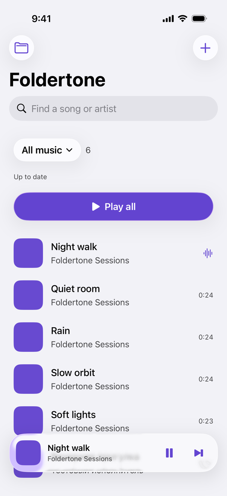
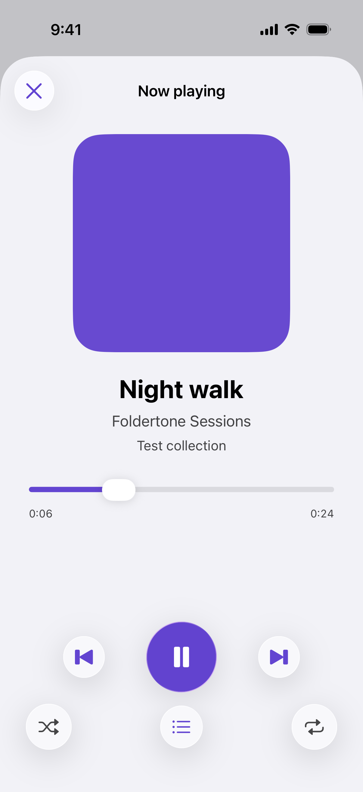

# Foldertone

**Your folders, your playlists.**

Foldertone plays the audio files you already own on your iPhone. Choose a
folder in Files and it becomes a playlist, with every track from its
subfolders in one flat list.

Add, rename, move or delete music in that folder and the playlist follows.
Your original files are only read, never changed.

[**Download on the App Store**](https://apps.apple.com/app/foldertone/id6832760685)
 · iOS 17+ · iPhone
 · [Website](https://wiltodelta.com/projects/foldertone/)
 · by [Victor Kuznetsov](https://wiltodelta.com/)

[](https://github.com/wiltodelta/foldertone/actions/workflows/build.yml)

<p align="center">
  <picture>
    <source media="(prefers-color-scheme: dark)" srcset="screenshots/library-dark.png">
    
  </picture>
</p>

## How it works

1. Choose a music folder through the system Files picker.
2. Its audio files, including every nested subfolder, appear in one flat playlist.
3. Press **Play all**. The compact player stays at the bottom; tap it for playback position, shuffle, repeat, and the queue. Play all keeps the shuffle mode last chosen in the player.

Tap the playing song to pause it and tap again to resume; touch and hold a song to play it from the beginning or remove it, or swipe it left to remove it. A removed song stays in Files and stays out of the playlist until you restore it under Sources > Removed Songs.

Each connected folder has a separate playlist. Choose among them with the playlist selector. Selecting one audio file starts it playing after its local copy is ready and does not create a playlist. Audio files can also open in Foldertone through the system document-opening flow.

The app supports multiple files and folders from On My iPhone, iCloud Drive, and connected Files providers, subject to the access those providers expose. It remembers the selected sources and playlist. Use Sources in the toolbar or Manage Sources in the playlist menu to rename, reconnect, or disconnect a source. Disconnecting leaves the original files in Files and keeps tracks shared with other sources.

<p align="center">
  <picture>
    <source media="(prefers-color-scheme: dark)" srcset="screenshots/player-dark.png">
    
  </picture>
</p>

## Install

Get Foldertone free from the
[App Store](https://apps.apple.com/app/foldertone/id6832760685). It needs an
iPhone with iOS 17 or later. Tap **+**, choose a folder or songs in Files, and
press **Play all**.

## Playback and metadata

The AVFoundation player handles MP3, FLAC, AAC/M4A, ALAC, WAV, and AIFF. The test bundle includes real synthetic samples for these codecs, including tagged MP3, FLAC, AAC, and ALAC. Codec decoding and tags are checked separately from physical-device playback.

Track titles, artists, albums, and embedded covers are read from file metadata. A file without a title uses its filename. A file without cover art gets the built-in placeholder. Covers are downsampled for display. The reader uses the full AVFoundation metadata collection so Vorbis text tags in FLAC are included, with a bounded RFC 9639 PICTURE parser for embedded FLAC covers that AVFoundation omits.

Shuffle builds an order containing each track once. Repeat can be off, repeat the playlist, or repeat one track. The player supports seeking, previous/next, an editable playback position through lock screen commands, background audio, and a visible **Up next** queue. Source changes update a playing playlist’s queue as well as its visible tracks.

## Your files stay yours

There is no account, no server, no ads and no tracking. Foldertone collects
no data; see the [privacy policy](docs/privacy.md). It reads the folders and
files you choose and keeps local playback copies on the device, excluded from
iCloud Backup.

## Folder synchronization

Adding, deleting, renaming, moving, and replacing music anywhere in a connected folder updates its flat playlist. The index stores a complete snapshot for each source. Overlapping folder and individual-file selections share tracks without duplicating them in the combined library. Matching audio moved within the same folder tree retains its track identity and offline copy; filename-based titles update after a rename.

The app subscribes to `NSFilePresenter` changes while in the foreground, coalesces bursts into one sync, and performs a full reconciliation when returning to the foreground. There is no periodic folder polling. Pending iCloud downloads get temporary file observers so completion can trigger import. An explicit file-change notification invalidates that file’s cached fingerprint even when its size and modification date are unchanged. Pull down to request an immediate retry.

A successful complete scan removes missing tracks. A failed root or incomplete directory traversal keeps the previous snapshot; temporary loss of access is not treated as deletion. If an existing file cannot be decoded, its last playable copy is kept and the source status reports the failure. Unused local audio and cover copies are cleaned up after playback state is reconciled. Local copies and the index are excluded from iCloud Backup because the originals stay in Files. Original files are only read.

Previously saved single-folder bookmarks, multi-source bookmarks, and the original array-based track index are migrated. Their tracks remain available if a source is unavailable during the first reconciliation.

## Build from source

Open `Foldertone.xcodeproj` in Xcode, choose scheme `Foldertone` and an iPhone simulator, then run. The deployment target is iOS 17.0. The app has no external dependencies or environment variables.

The project uses automatic signing with development team `K2GT9Q4S6U` for the app and test targets. An iPhone build requires an Apple Development signing identity and a matching provisioning profile for the selected device. Sign in to this team in Xcode Settings > Apple Accounts, connect the iPhone, and select it as the run destination so Xcode can manage the profile. Signing is not required for a simulator build.

### Verify

```sh
scripts/check-ui.sh
```

The runner creates a unique device from an installed iOS runtime, runs without opening Simulator.app, and deletes only its own device afterward. Use `--dry-run` to inspect the selection, `--only-testing FoldertoneUITests/FoldertoneUITests/testEmptyLibraryAndMusicPicker` for a focused UI check, and `--out PATH` to retain logs and the result bundle in a chosen folder. `IOS_UI_RUNNER` overrides the shared runner path. `FoldertoneTests` covers recursive synchronization, source failures, legacy migration, cache safety, folder playlists, single-file routing, codec metadata, event delivery, shuffle, repeat, and queue reconciliation. Run `scripts/check-engine.sh` for isolated macOS engine checks using the same shared scenarios. An optional scenario name limits the check, for example `scripts/check-engine.sh formats`. It creates and removes its own temporary workspace and never uses a personal music folder. The UI tests cover the system picker and playback flows. See [verification status](docs/verification.md) for completed and blocked checks.

[GitHub Actions](.github/workflows/build.yml) runs the non-UI checks on every push and pull request; the UI suite stays local because it drives the system Files picker. Check formatting locally with `xcrun swift-format lint --strict --recursive Foldertone FoldertoneTests FoldertoneUITests scripts`.

UI tests launch with the Debug-only `--isolated-storage` argument, which keeps sources, the index, local copies and the selected playlist in separate test storage, so the suite can run on your own iPhone without touching its library.

For a populated simulator preview, add `--sample-library` to the scheme's launch arguments. This Debug-only option creates synthetic tones without personal music or an iCloud account.

### Screenshots

`scripts/capture-screenshots.sh MUSIC_FOLDER` regenerates the README
screenshots in light and dark appearance on its own simulator and deletes it
afterward. Give it a folder of synthetic audio only; the folder name becomes
the playlist name.

### App icon

The icon follows the other apps’ visual style: a violet vertical gradient, a white glass folder, and one purple Play symbol. `scripts/draw-icon.py` generates the closed SVG layers and `Foldertone/AppIcon.icon` document. Regenerate with `python3 scripts/draw-icon.py`; edit the generator rather than its output. Xcode compiles the layered icon and fallback images for the existing deployment target.

### Device behavior

File presenters are unregistered when the app enters the background, as required by iOS. Reopening the app reconciles changes made while it was suspended. Background audio operates separately from source monitoring. File-provider notification delivery, security-scoped bookmark persistence, iCloud downloads, lock screen commands, and accessory playback need verification on an iPhone.

Apple references: [file presenters](https://developer.apple.com/documentation/foundation/nsfilepresenter), [iOS presenter lifecycle](https://developer.apple.com/documentation/foundation/nsfilecoordinator), [directory access](https://developer.apple.com/documentation/uikit/providing-access-to-directories), [media metadata](https://developer.apple.com/documentation/avfoundation/retrieving-media-metadata), and [background playback](https://developer.apple.com/documentation/avfoundation/configuring-your-app-for-media-playback).

### Release

See the [App Store release procedure](docs/release.md) and the [privacy policy](docs/privacy.md).

## Help

Questions and problems go to the
[support page](https://wiltodelta.com/projects/foldertone/support/) or to this
repository's issues.

## License

[Apache License 2.0](LICENSE).

Made by [Victor Kuznetsov](https://wiltodelta.com/).
