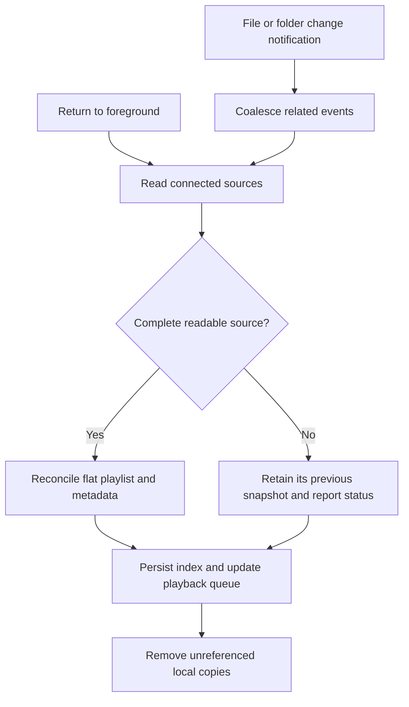

# Product model

Foldertone is for listening to a personal collection of audio files. Its primary unit is a folder playlist: the user chooses a folder, sees its tracks, and starts listening.

## Library

The main screen uses a native navigation title, toolbar actions, a checked playlist picker, and system search within the current selection. A single prominent Play all acts on the filtered tracks and keeps the shuffle mode last chosen in the player; shuffle and repeat controls live only in the player. Each folder is a named playlist, with all nested audio flattened into the same list. All music combines the sources without duplicating overlapping selections. The selected playlist is restored across launches, with All music as the fallback after its source is disconnected. Version 1.0 is iPhone-only. The privacy policy is linked from the empty library and the Sources sheet, with support beside it in Sources.

Choosing one audio file requests immediate playback once the local copy is ready. It does not create a folder playlist. The same behavior handles a file opened through the system document-opening flow.

## Appearance

Controls use native Liquid Glass on iOS 26 and later: the native toolbar and search, playlist selector, Play all, mini-player, and expanded playback controls. Earlier supported iOS versions use standard button styles and system materials. Shared track rows use semantic text colors and hide decorative artwork at accessibility text sizes in both the library and queue. Nearby glass buttons share a glass effect container; buttons inside the mini-player use its single glass surface rather than stacking glass layers. The expanded player's control panel has an opaque backing to keep scrolling metadata from overlapping the controls. Its icon-only controls cap symbol scaling at the largest standard Dynamic Type size while retaining their accessibility labels. Active shuffle and repeat modes have a visible mark in addition to color.

## Player

A compact player exposes the current track, play/pause, and next. The expanded player shows the embedded cover, title, artist, playback position, previous/next, shuffle, repeat, and Up next. Playback continues through screen locking and backgrounding, subject to the device audio session.

In short landscape windows, the expanded player uses artwork beside scrollable metadata and a compact horizontal control strip. At accessibility text sizes, decorative landscape artwork is omitted to give the metadata more room. Closing the player uses the leading cancellation action.

Shuffle defines an order rather than choosing a random track independently at every transition. That allows a complete pass without unintended repeats and makes previous and next predictable. Repeat is a separate choice: off, playlist, or current track.

## Source of truth

The connected folder determines playlist membership. A complete recursive scan updates additions, removals, filename changes, moves, and replaced audio. Each source has an independent persisted membership snapshot. Shared tracks can belong to multiple playlists.

A failed root or incomplete traversal does not establish deletion. Its last complete membership stays available and the status reports the problem. Cached audio provides playback while a source is temporarily unavailable. Confirmed removals update both the playlist and its playback queue before unreferenced local copies are removed.

Sources can be managed from the toolbar or playlist menu. Names come from the localized Files resource name, with technical File Provider Storage names presented as Files. A custom name affects only Foldertone and survives synchronization and reconnection. Reconnecting preserves the source and playlist identity, requires the same source kind, and rejects an already connected location. Disconnecting requires confirmation, removes only membership unique to that source, and never writes to or deletes original files. Shared tracks remain in other connected playlists. Source edits wait until synchronization finishes.

## Updating

File presenters are active only in the foreground. A foreground reconciliation catches missed background changes. An iCloud file still downloading is temporarily observed as an individual item so its completion can trigger another pass. A notification identifying a changed file bypasses the size/date cache check, including edits made by tag editors that preserve modification times.

## Format handling

AVFoundation performs decoding. Synthetic MP3, FLAC, AAC/M4A, ALAC, WAV, and AIFF fixtures exercise the importer, with embedded title, artist, album, and artwork in the tagged formats. A filename and built-in image cover missing metadata. Source failures are reported rather than silently presented as a successful empty playlist.
